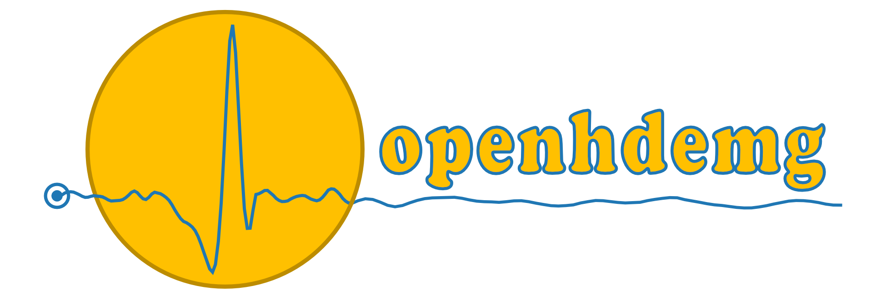
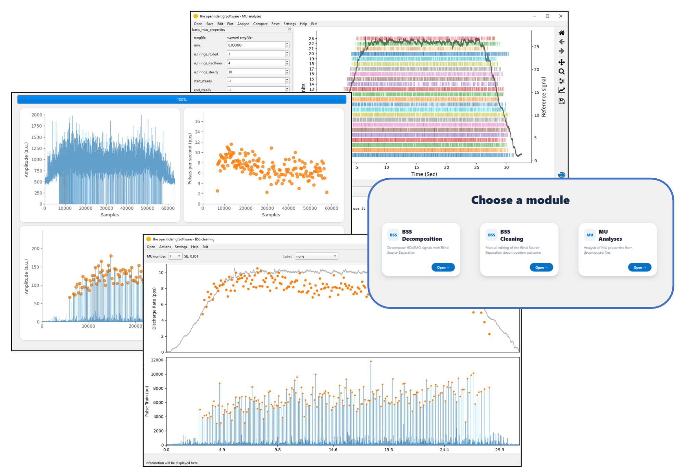

  

# The openhdemg software

The *openhdemg software* is a Windows desktop application for the decomposition, cleaning, and analysis of high-density surface electromyography (HDsEMG) recordings.

This repository distributes the application, user documentation, and accompanying material through **GitHub Releases**. The application builds on the [*openhdemg* Python library](https://github.com/GiacomoValliPhD/openhdemg).

**[Download for Windows](https://github.com/GiacomoValliPhD/openhdemg-software/releases)** · **[Software website](https://www.giacomovalli.com/openhdemg_software/)** · **[Release notes](https://www.giacomovalli.com/openhdemg_software/releases/)**

## Teaser

## Key features

- **BSS Decomposition:** decompose multichannel EMG recordings using convolutive blind source separation, with channel inspection, signal preprocessing, and single-file or batch processing.
- **BSS Cleaning:** inspect and edit MU firings, update separation filters, label MUs, and identify duplicates.
- **MU Analyses:** analyse motor unit properties and export results.
- **Interactive visualisation:** explore EMG and reference signals, MU discharge patterns, and motor unit action potentials (MUAPs).
- **Motor unit tracking:** compare MUs across recordings using MUAP cross-correlation.
- **Connected workflow:** transfer the current file directly between decomposition, cleaning, and analysis.
- **Flexible data access:** save data as *openhdemg* modules, adapt imports with custom Python functions, and extend analyses through the integrated Python terminal.

## Preview

## Quick installation

**Windows only.** Python and the required libraries are included; no separate Python installation or virtual environment is needed.

**Read the user manual** before installing or using the software! It explains the installation steps, recommended workflow, and troubleshooting. If you encounter a problem, check the relevant section first. If the problem persists, open a GitHub issue using the provided template so we can investigate.

To find the software and the user manual:

1. Open the [Releases page](https://github.com/GiacomoValliPhD/openhdemg-software/releases) and download the application ZIP attached to the release you want to use. Select the application package from **Assets**; GitHub's **Source code** archives contain the repository files.
2. Extract the **entire ZIP** to a stable local folder where you have write access. Avoid `Program Files`, other protected system folders, and synchronised folders such as OneDrive.
3. Open the extracted folder and run the software executable. Keep the executable together with the rest of the application files; create a shortcut if you want desktop access.
4. Read and accept the end-user licence agreement, then choose **BSS Decomposition**, **BSS Cleaning**, or **MU Analyses** to begin.

The application also opens a terminal window for diagnostic messages. You can minimise it, but keep it open while using the software: closing it closes the application.

## Documentation and release notes

Look under the corresponding [GitHub release](https://github.com/GiacomoValliPhD/openhdemg-software/releases) for the user manual, accompanying material, changes, and known issues. Only use the manual matching your software version.

Complete [release notes](https://www.giacomovalli.com/openhdemg_software/releases/) are available on the software [website](https://www.giacomovalli.com/openhdemg_software/).

## Support the project and cite our work

If you find the *openhdemg software* useful, please consider giving [this repository a star ⭐](https://github.com/GiacomoValliPhD/openhdemg-software). It is a simple way to show your appreciation and help others discover the project.

If you use *openhdemg* in your research, please cite the original paper:

> Valli G, Ritsche P, Casolo A, Negro F, De Vito G. Tutorial: analysis of central and peripheral motor unit properties from decomposed High-Density surface EMG signals with openhdemg. *Journal of Electromyography and Kinesiology*. 2024; 102850. [https://doi.org/10.1016/j.jelekin.2023.102850](https://doi.org/10.1016/j.jelekin.2023.102850).

Please also cite the relevant publications for the methods used in your analyses. The [citation guide](https://www.giacomovalli.com/openhdemg/cite-us/) provides the primary reference and method-specific citations.

## Request a feature

Have an idea to improve the *openhdemg software*? [Submit a feature request](https://github.com/GiacomoValliPhD/openhdemg-software/issues/new?template=feature_request.yml), explaining the problem you want to solve and how the proposed feature would help your workflow.

## Help and licence

For help, consult the user manual or [open a GitHub issue](https://github.com/GiacomoValliPhD/openhdemg-software/issues/new/choose) using the provided issue template. Please complete the template with your software version, the module and operation involved, and the relevant error message or log.

Use of the compiled application is governed by its end-user licence agreement, shown at first launch and available from **Help > Show EULA**.
